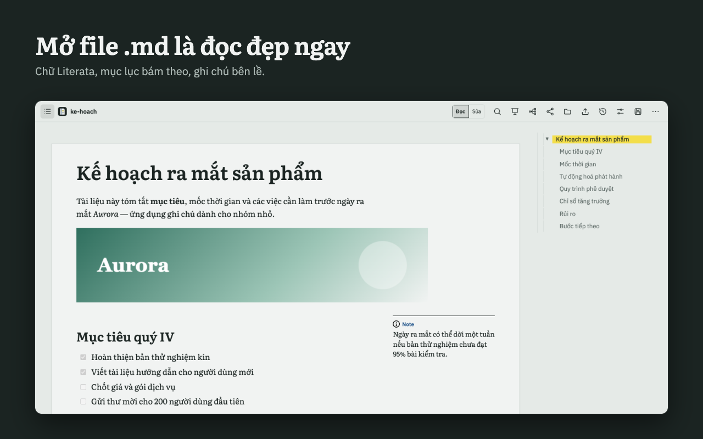
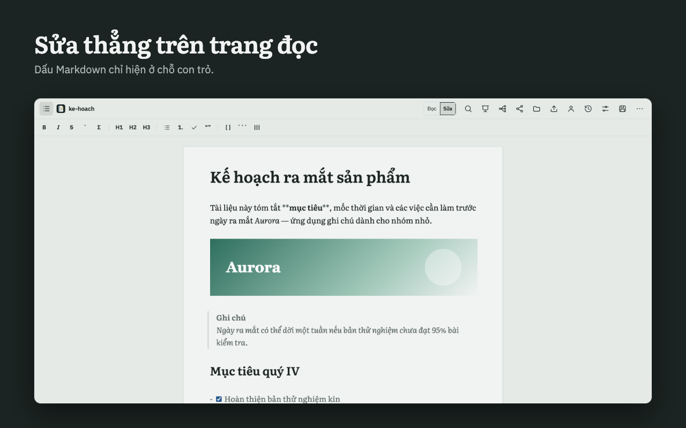
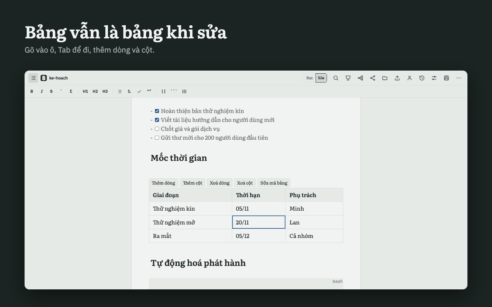
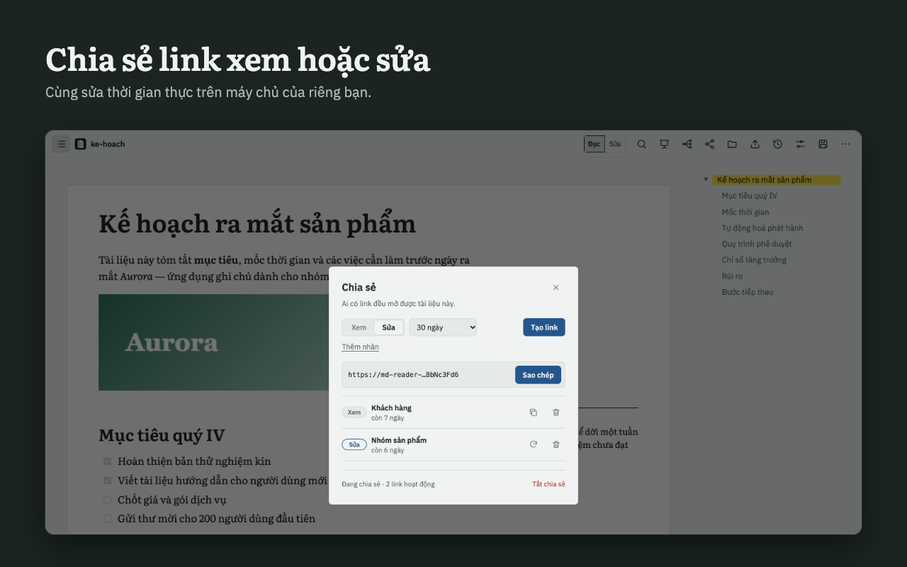
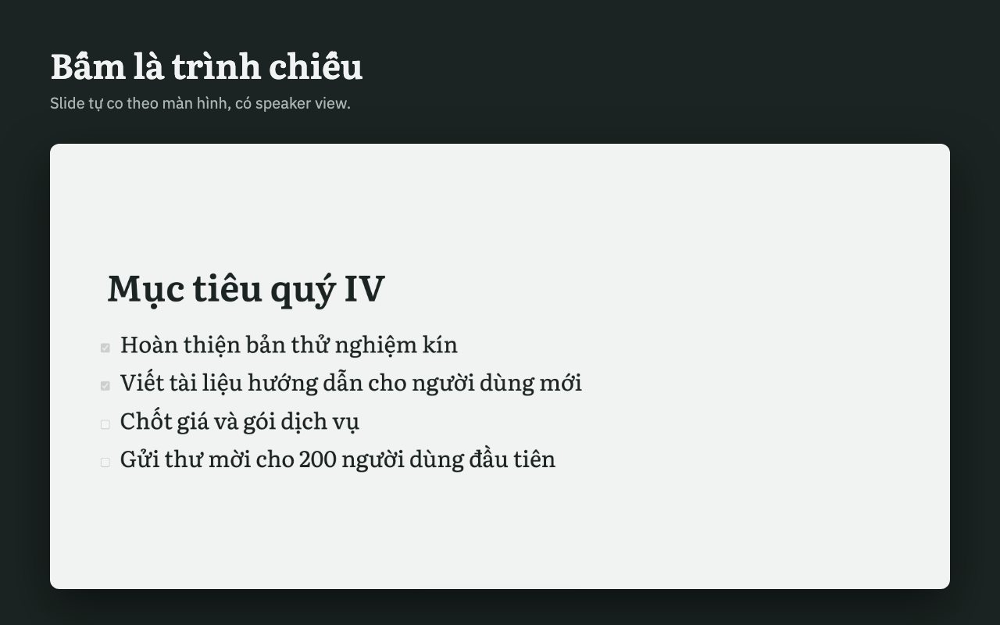
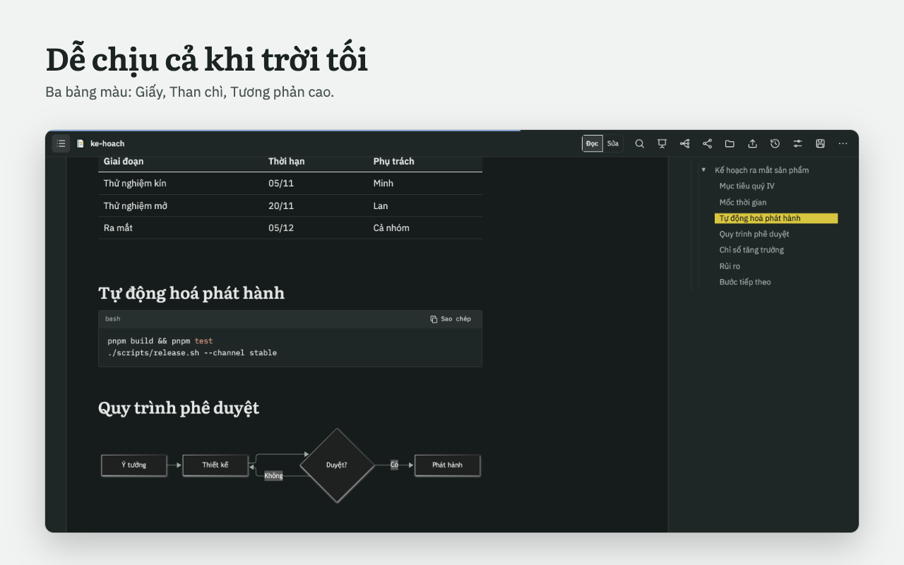
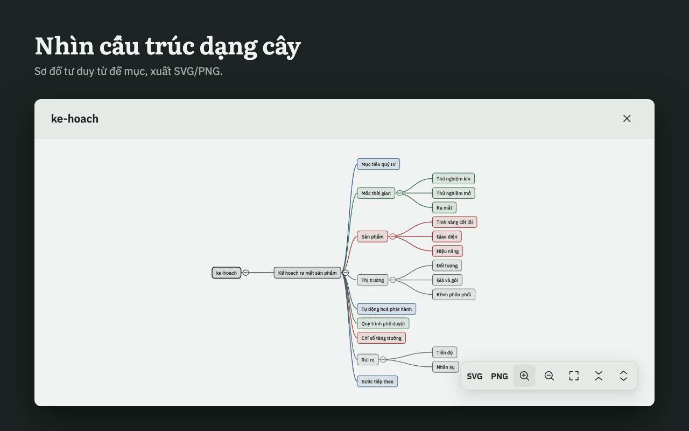

<p align="center">
  
</p>

<h1 align="center">MD Reader</h1>

<p align="center">
  <b>Read beautifully. Edit right on the page. Co-edit via a link. Present instantly.</b><br>
  A browser extension that turns any Markdown file into a calm reading page, then lets you edit, share and present it. Runs on your machine; sharing is optional.
</p>

<p align="center">
  <a href="https://github.com/winwin1808/md-reader/actions/workflows/ci.yml"></a>
  <a href="LICENSE"></a>
  
  
  
</p>

<p align="center"><b>English</b> · <a href="README.vi.md">Tiếng Việt</a></p>

<p align="center">
  <a href="https://gist.github.com/winwin1808/89e2f4a64e07b59ad6518c7b9d947fca">Website</a> ·
  <a href="docs/ROADMAP.en.md">Roadmap</a> ·
  <a href="docs/SELF_HOST.md">Self-host sharing</a> ·
  <a href="https://github.com/winwin1808/md-reader/issues">Feedback</a>
</p>

<p align="center">
  
</p>

## Why MD Reader

There are plenty of Markdown viewers. MD Reader tries to do three things a reading page usually doesn't:

1. **Edit right on the reading page.** No separate editor window. The page looks like it does when reading; Markdown marks only appear where the cursor is. Tables are typeable grids, pasting an image just works, saving writes straight back to the file, and you get a warning if the file was changed elsewhere.
2. **Co-edit via a link.** Create a view link or an edit link, let several people edit at once, see who has it open, see which line was written by whom, and restore older versions. The server is your own Cloudflare Worker (free tier), so your data never passes through a third party.
3. **Presentations with a speaker view.** One Markdown file becomes a slide deck: clock, next slide and speaker notes in a separate window, synced with the projector screen. Landscape slide PDF export included.

Common ground: no account, no tracking, bundled fonts, MIT open source.

## Features

<table>
  <tr>
    <td width="50%" valign="top">
      
      <h4>Comfortable reading</h4>
      Literata type, a readable column width, a table of contents that follows the section you are reading, <code>[!NOTE]</code> callouts set in the margin. Tables, KaTeX, mermaid, excalidraw, highlighted code with a copy button. Search the document with ⌘F.
    </td>
    <td width="50%" valign="top">
      
      <h4>Edit right on the page</h4>
      Two modes, Read / Edit, with live preview. Images, checkboxes, code, callouts, formulas and mermaid render as you edit. Switching modes keeps your position. Save to disk with ⌘S, with a diff when the file changed outside.
    </td>
  </tr>
  <tr>
    <td width="50%" valign="top">
      
      <h4>Grid tables</h4>
      Type straight into cells, move with Tab / Enter / ↑↓, add or delete rows and columns; click "Edit table source" if you need to. Paste or drag images: small ones are embedded in the file, large ones go to an <code>assets/</code> folder next to the file, and shared documents upload to the server.
    </td>
    <td width="50%" valign="top">
      
      <h4>Share and co-edit</h4>
      View or edit links, realtime collaboration, presence, per-line blame, history and restore. Revoking a link blocks access immediately. Requires a self-hosted server (see below).
    </td>
  </tr>
  <tr>
    <td width="50%" valign="top">
      
      <h4>Present</h4>
      Split slides on <code>---</code> or headings, scaled automatically to the screen. The speaker view has a clock, the next slide and notes; export a landscape slide PDF.
    </td>
    <td width="50%" valign="top">
      
      <h4>Three palettes</h4>
      Paper, Graphite (dark), High contrast. The interface follows the browser language (Vietnamese / English) and can be changed in Settings → Language.
    </td>
  </tr>
  <tr>
    <td width="50%" valign="top">
      
      <h4>Mind map</h4>
      Built from headings, colored by branch, keyboard navigation, zoom and pan, click a node to scroll to that passage. Export SVG / PNG (⌘M to open).
    </td>
    <td width="50%" valign="top">
      <h4>Export</h4>
      Single-file HTML, PDF (printed from the browser with dedicated print CSS), Word <code>.docx</code>, slide PDF. All in the Margin Book look.
      <h4>Privacy</h4>
      No account, no tracking, no default server. Only if you turn on sharing on your own server does that document leave your machine. See the <a href="docs/store/privacy-policy.md">privacy policy</a>.
    </td>
  </tr>
</table>

## Supported platforms

| Platform | Status | Notes |
|---|---|---|
| Chrome | **Yes** | Install from source or the release zip; Chrome Web Store is being prepared. |
| Edge | **Yes** | Use the Chrome zip as is. Edge Add-ons page: planned. |
| Brave / Opera / Arc / Vivaldi | **Yes** | Same Chromium core, use the Chrome zip. |
| Firefox (MV3, 128+) | **Limited** | A build exists. No File System Access API, so no Open file / save straight to disk / images into `assets/`; some permissions must be granted manually. Details: [`docs/PLATFORMS.md`](docs/PLATFORMS.md). |
| Chrome Web Store / Edge Add-ons / Firefox AMO | **In progress** | Listing material and images are ready; waiting to publish. |
| VS Code, Obsidian | **Planned** | See the [roadmap](docs/ROADMAP.en.md). |
| Web app (drop a file, no install) | **Planned** | See the [roadmap](docs/ROADMAP.en.md). |
| Mobile | **Planned** | Last. |

## Roadmap summary

Phases 1 to 9 are done (reading, export, presenting, mind map, safe editing and saving to disk, hardening, Margin Book look, sharing and collaboration, editing on the page). Next:

- **v1.3, Share with AI (MCP):** an MCP server so Claude, ChatGPT, Cursor... can publish a Markdown document and get back a view/edit link.
- **v1.4:** more diagram types (PlantUML, Graphviz, Vega, ECharts, draw.io), OpenAPI, EPUB / XLSX export, more document themes.
- **v1.5:** comments, a room-data deletion endpoint, rate limiting, one-click deploy to Cloudflare, store releases.
- **v2.0:** VS Code, Obsidian, a no-install web app, CLI.

This is a plan, not a delivery-date commitment. Full version in [`docs/ROADMAP.en.md`](docs/ROADMAP.en.md).

## Sharing & collaboration (optional, self-hosted)

- **MD Reader ships with no server.** Sharing needs a sync server of your own: a Cloudflare Worker running on the free tier (Durable Objects + D1). The first time you click Share without a server, the dialog shows the setup steps and a box to paste the address.
- Step-by-step guide: [`docs/SELF_HOST.md`](docs/SELF_HOST.md). In short: `wrangler login`, create D1, `wrangler d1 migrations apply … --remote`, `pnpm deploy:api`, then paste your Worker's address into MD Reader.
- Turning sharing off or revoking a link only blocks access; it does not yet delete data stored on your server (a deletion endpoint is on the roadmap).

## Installation

### From the Chrome Web Store

Coming soon.

### From source

Requires Node.js and [pnpm](https://pnpm.io) 10.

```bash
git clone https://github.com/winwin1808/md-reader.git
cd md-reader
pnpm install
pnpm --filter extension build
```

Then open `chrome://extensions`, turn on **Developer mode**, choose **Load unpacked** and point to the `apps/extension/dist` folder. For solo use that is all you need, nothing to deploy. When there is new code: `git pull && pnpm install && pnpm --filter extension build`, then click **Reload** on MD Reader.

To make the build aware of your sharing server's address: create `apps/extension/.env.local` (gitignored) with the line `VITE_MDR_SERVER_URL=<your Worker address>`.

> **Tip:** to read local files (`file://`), go to `chrome://extensions` → MD Reader → turn on **"Allow access to file URLs"**.

Edge, Brave and other Chromium browsers: load the same `dist` folder. Firefox: `pnpm --filter extension package:firefox`, see [`docs/PLATFORMS.md`](docs/PLATFORMS.md).

## Keyboard shortcuts

On Windows/Linux use `Ctrl` in place of `⌘`.

| Key | Action |
|---|---|
| ⌘F | Search in document |
| ⌘S | Save to the file on disk |
| ⌘M | Open the mind map |
| ⌘B / ⌘I / ⌘K | Bold / italic / insert link (in the editor) |
| ← → / Space | Previous / next slide (when presenting) |
| Esc | Exit presentation |
| `?speaker=true` | Add to the URL to open the speaker view |

## Architecture

pnpm workspaces monorepo:

| Package | Role |
|---|---|
| `packages/core` | Pure TypeScript: `unified`/`remark` parser, Yjs document model, slides, mind map, export. No React or `chrome.*`. |
| `packages/ui` | React components (Viewer, Editor, Deck, Mindmap, ...). No `chrome.*`. |
| `apps/extension` | The MV3 extension shell (app page, content script, build). The only layer allowed to use `chrome.*`. |
| `apps/api` | Self-hosted sync server: Cloudflare Worker, Durable Object (Yjs over WebSocket) + D1 (links, images). |
| `apps/web` | The `/s/<token>` page for people you share with: view or edit right on the page. |

Key principles:

- **`Y.Doc` (Yjs) is the source of truth**; the `.md` file is only an import/export gateway. Local storage uses IndexedDB (`y-indexeddb`).
- The content script **does not use Yjs** and keeps a **≤ 60 KB gzip** budget (currently about 13 KB).
- Edit mode is a CodeMirror 6 live preview directly on `Y.Text`, so the `.md` file keeps every character intact; collaboration, undo and history are unchanged.
- Stack: Vite, React, TypeScript, vitest, Playwright, CodeMirror 6, Cloudflare Workers.

## Development

```bash
pnpm test                          # run tests for every package
pnpm --filter core test            # packages/core
pnpm --filter ui test              # packages/ui
pnpm --filter extension test       # apps/extension (unit)
pnpm typecheck                     # tsc --noEmit for every package
pnpm --filter extension build      # build into apps/extension/dist
pnpm --filter extension e2e        # Playwright (builds, then runs)
pnpm --filter extension package    # zip for the Chrome Web Store
pnpm --filter api test             # sync server
pnpm deploy:site                   # deploy the website (Cloudflare Pages)
pnpm deploy:api                    # deploy your server (see docs/SELF_HOST.md)
```

The store submission process is in [`docs/store/README.md`](docs/store/README.md); detailed design in [`docs/DESIGN.md`](docs/DESIGN.md) (Vietnamese).

## License and contact

[MIT](LICENSE) license. Feedback and bug reports: [GitHub Issues](https://github.com/winwin1808/md-reader/issues).
