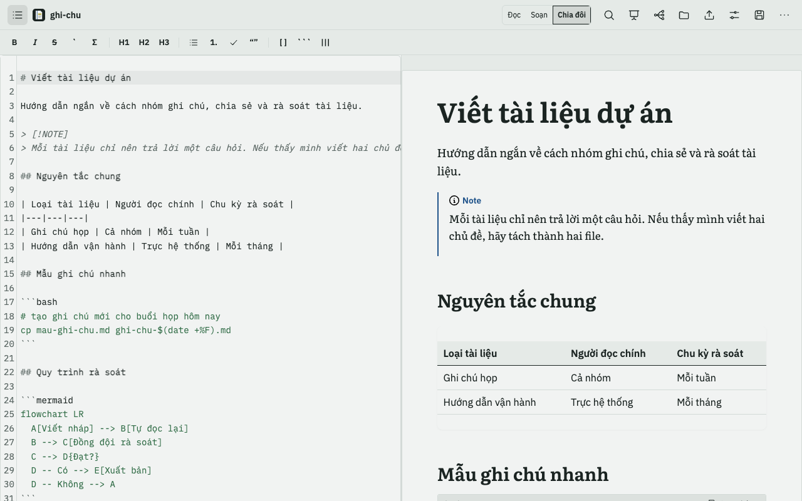

<p align="center">
  
</p>

<h1 align="center">MD Reader</h1>

<p align="center">
  Đọc, soạn, trình chiếu và xuất Markdown ngay trong Chrome. Chạy trên máy; chia sẻ là tuỳ chọn.
</p>

<p align="center">
  
  
  
</p>

> **TL;DR (English)** — MD Reader is a Chrome (MV3) extension that turns any `.md` file into a calm reading page, with a CodeMirror editor and split view, slides with speaker view, mind maps, and export to HTML / PDF / Word. No account, no tracking: documents and settings stay in your browser unless you turn on optional sharing, which you can self-host.

## 📖 Giới thiệu

MD Reader biến file Markdown thành một trang đọc dễ chịu, ngay trong Chrome. Bấm vào link `.md` (GitHub raw, file trên máy) là mở trang đọc với chữ Literata, cột chữ vừa mắt và giao diện "Lề sách".

<p align="center">
  
</p>

## ✨ Tính năng

### Đọc

- Mở link `.md` là đọc đẹp ngay, tuỳ chỉnh độ rộng trang.
- Mục lục bên trái đánh dấu mục bạn đang đọc; ghi chú `[!NOTE]` nằm gọn bên lề.
- Bảng, công thức toán (KaTeX), sơ đồ mermaid, excalidraw, khối code tô màu và nút sao chép.
- Ba bảng màu: Giấy, Than chì (tối), Tương phản cao. Tìm trong tài liệu (⌘F).

<table>
  <tr>
    <td width="50%"></td>
    <td width="50%"></td>
  </tr>
  <tr>
    <td align="center"><sub>Giấy</sub></td>
    <td align="center"><sub>Than chì (tối)</sub></td>
  </tr>
</table>

### Soạn

- Trình soạn thảo CodeMirror, thanh định dạng, ⌘B / ⌘I / ⌘K.
- Chia đôi màn hình: soạn bên trái, xem bên phải, cuộn đồng bộ.
- Lưu thẳng về file trên đĩa (⌘S), phát hiện khi file bị sửa ở nơi khác và cho so sánh trước khi ghi đè.

<p align="center">
  
</p>

### Trình bày

- Bấm Trình chiếu: tách slide theo `---` hoặc đề mục, tự co giãn theo màn hình.
- Speaker view có đồng hồ, slide kế tiếp và ghi chú diễn giả.
- Sơ đồ tư duy từ các đề mục, đi được bằng bàn phím, xuất SVG/PNG.

<table>
  <tr>
    <td width="50%"></td>
    <td width="50%"></td>
  </tr>
  <tr>
    <td align="center"><sub>Trình chiếu</sub></td>
    <td align="center"><sub>Sơ đồ tư duy</sub></td>
  </tr>
</table>

### Xuất

HTML một file, PDF (in từ trình duyệt), Word (`.docx`), PDF slide khổ ngang.

### Chia sẻ & cộng tác

- Tạo link xem hoặc link sửa, cùng sửa một tài liệu theo thời gian thực, thấy ai đang mở và xem dòng nào do ai viết.
- Tính năng này là tuỳ chọn và tắt theo mặc định. Khi chưa bật, không có gì rời khỏi trình duyệt.
- Tự host: `pnpm deploy:api` triển khai `apps/api` lên tài khoản Cloudflare của bạn (gói Workers Free), dùng Durable Objects (SQLite) và D1, không cần R2 hay KV. Cần đặt biến môi trường `CLOUDFLARE_API_TOKEN` (token của bạn, đừng commit vào repo).
- Sau khi triển khai, nhập địa chỉ máy chủ (ví dụ `https://<ten-worker>.<tai-khoan>.workers.dev`) tại Cài đặt → Cộng tác.
- Chạy thử cục bộ: `pnpm --filter @md-reader/extension e2e:collab` (dùng `wrangler dev` chạy cục bộ).
- Chi tiết dữ liệu nào được gửi đi: [chính sách riêng tư](docs/store/privacy-policy.md).

### Riêng tư

Không tài khoản, không theo dõi. Mặc định tài liệu và cài đặt chỉ nằm trong trình duyệt của bạn; chỉ khi bạn bật chia sẻ thì nội dung tài liệu được chia sẻ mới đi qua máy chủ do bạn chọn. Font được đóng gói sẵn, không gọi ra ngoài khi đọc. Xem [chính sách riêng tư](docs/store/privacy-policy.md).

## 🚀 Cài đặt

### Từ Chrome Web Store

Sắp có.

### Từ mã nguồn

Yêu cầu Node.js và [pnpm](https://pnpm.io) 10.

```bash
git clone https://github.com/winwin1808/md-reader.git
cd md-reader
pnpm install
pnpm --filter extension build
```

Sau đó mở `chrome://extensions`, bật **Developer mode**, chọn **Load unpacked** và trỏ tới thư mục `apps/extension/dist`.

> **Mẹo:** muốn đọc file trên máy (`file://`), vào `chrome://extensions` → MD Reader → bật **"Cho phép truy cập URL tệp"** (*Allow access to file URLs*).

## ⌨️ Phím tắt

Trên Windows/Linux dùng `Ctrl` thay cho `⌘`.

| Phím | Tác dụng |
|---|---|
| ⌘F | Tìm trong tài liệu |
| ⌘S | Lưu về file trên đĩa |
| ⌘M | Mở sơ đồ tư duy |
| ⌘B / ⌘I / ⌘K | In đậm / in nghiêng / chèn liên kết (trong trình soạn) |
| ← → / Space | Slide trước / sau (khi trình chiếu) |
| Esc | Thoát trình chiếu |
| `?speaker=true` | Thêm vào URL để mở speaker view |

## 🧱 Kiến trúc

Monorepo pnpm workspaces:

| Package | Vai trò |
|---|---|
| `packages/core` | TypeScript thuần: parser `unified`/`remark`, mô hình tài liệu Yjs, slide, mindmap, export. Không dùng React hay `chrome.*`. |
| `packages/ui` | Thành phần React (Viewer, Editor, Deck, Mindmap, ...). Không dùng `chrome.*`. |
| `apps/extension` | Vỏ extension MV3 (app page, content script, build). Lớp duy nhất được dùng `chrome.*`. |

Nguyên tắc chính:

- **`Y.Doc` (Yjs) là nguồn sự thật**; file `.md` chỉ là cổng import/export. Lưu cục bộ bằng IndexedDB (`y-indexeddb`).
- Content script **không dùng Yjs** và giữ ngân sách **≤ 60 KB gzip** (hiện khoảng 12 KB).
- Stack: Vite, React, TypeScript, vitest, Playwright, CodeMirror 6.

## 🛠️ Phát triển

```bash
pnpm test                          # chạy test mọi package
pnpm --filter core test            # packages/core
pnpm --filter ui test              # packages/ui
pnpm --filter extension test       # apps/extension (unit)
pnpm typecheck                     # tsc --noEmit mọi package
pnpm --filter extension build      # build vào apps/extension/dist
pnpm --filter extension e2e        # Playwright (build rồi chạy)
pnpm --filter extension package    # đóng gói zip cho Chrome Web Store
```

Quy trình đưa lên Chrome Web Store (listing, ảnh, giải trình quyền) nằm ở [`docs/store/README.md`](docs/store/README.md). Thiết kế chi tiết ở [`docs/DESIGN.md`](docs/DESIGN.md).

## 🗺️ Roadmap

| Phase | Nội dung | Trạng thái |
|---|---|---|
| 1 | Nền tảng và trình đọc | Xong |
| 2 | Xuất HTML / PDF / Word | Xong |
| 3 | Trình chiếu, speaker view | Xong |
| 4 | Mindmap và Excalidraw | Xong |
| 5 | Chỉnh sửa, lưu đĩa an toàn | Xong |
| 6 | Gia cố (không mất/nhân đôi chữ, quyền tối thiểu, Playwright) | Xong |
| 7 | Giao diện Lề sách và logo | Xong |
| 8 | Chia sẻ và cộng tác (Cloudflare Workers) | Đang thực hiện |

## 📄 Giấy phép và liên hệ

Chưa khai báo giấy phép trong repo; mọi quyền được giữ cho tới khi có file `LICENSE`. Góp ý và báo lỗi: [GitHub Issues](https://github.com/winwin1808/md-reader/issues).
